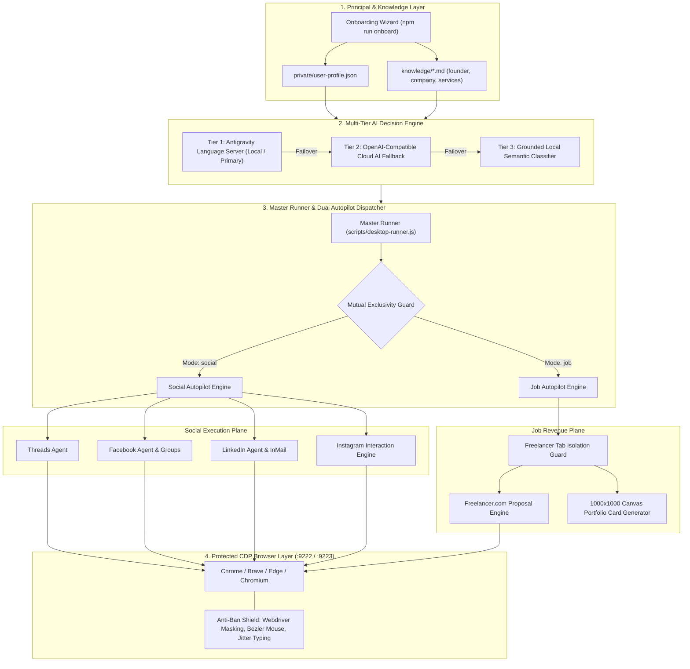
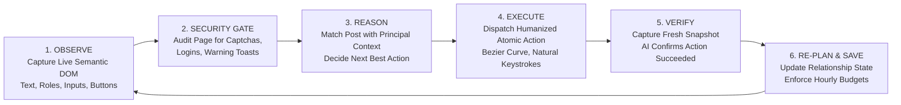
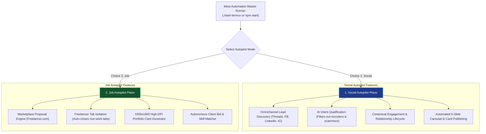
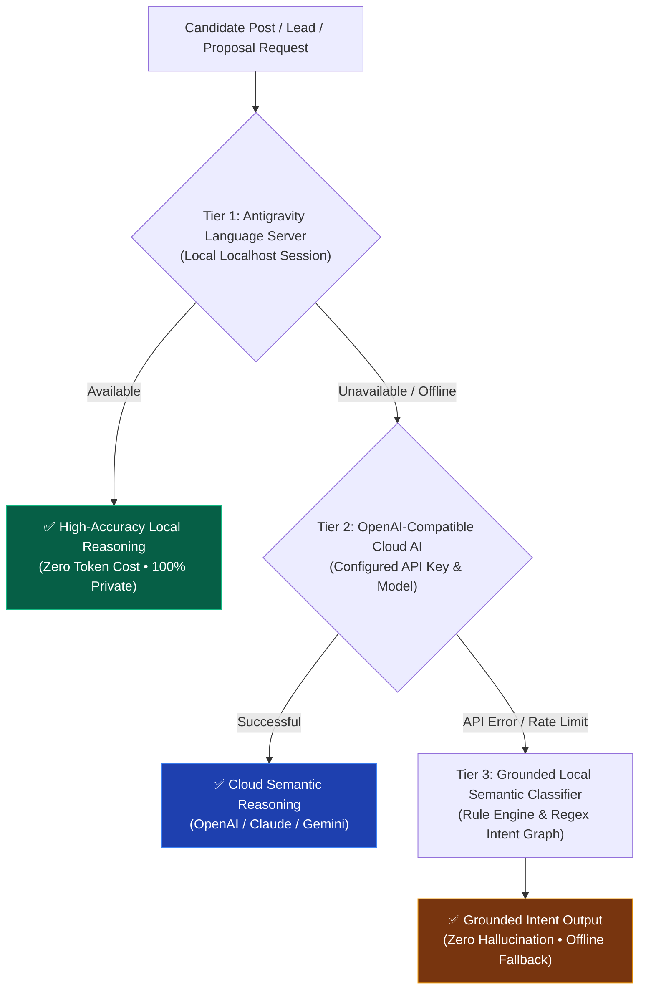

# Agentic Automation 🤖

[](https://github.com/sunmughan/meta-automation)
[](https://github.com/sunmughan/meta-automation)
[-ef4444.svg)](https://github.com/sunmughan/meta-automation)
[-8b5cf6.svg)](https://github.com/sunmughan/meta-automation/releases/tag/v2.1.0)
[](https://github.com/sunmughan/meta-automation)
[](https://nodejs.org)
[](LICENSE)

> **Repository URL Compatibility Notice:** The repository slug remains `meta-automation` for upstream URL compatibility. The product architecture and execution plane is **Agentic Automation** — an autonomous, principal-aware browser agent runtime that learns who it represents, reasons over live web state, and safely executes verified work across social channels and client marketplaces.

Built and maintained with ❤️ by **[Sunmughan Swamy](https://github.com/sunmughan)** at **[CodeAir Software Solutions](https://www.codeair.tech)**.

---

## 📑 Table of Contents

- [Executive Overview](#-executive-overview)
- [System Architecture](#-system-architecture)
- [The Closed-Loop Agentic Reasoning Cycle](#-the-closed-loop-agentic-reasoning-cycle)
- [Dual Autopilot Architecture (Social vs. Job Engine)](#-dual-autopilot-architecture)
- [Multi-Layer Anti-Ban & Cross-Platform Stealth](#-multi-layer-anti-ban--cross-platform-stealth)
- [Platform Support & Capability Matrix](#-platform-support--capability-matrix)
- [Multi-Tier AI Decision Engine](#-multi-tier-ai-decision-engine)
- [3-Minute Multi-Platform Quickstart](#-3-minute-multi-platform-quickstart)
  - [Guided Onboarding Wizard](#1-first-time-onboarding-wizard)
  - [Linux & macOS](#2a-linux--macos-quickstart)
  - [Windows 10/11 (PowerShell & CMD)](#2b-windows-1011-quickstart)
  - [Android Termux (24/7 Mobile Daemon)](#2c-android-termux--termuxx11-247-mobile-daemon)
- [Where Information Lives & Privacy Model](#-where-information-lives--privacy-model)
- [Security & Safe Handoff Model](#-security--safe-handoff-model)
- [CLI Reference & Operations Cheat Sheet](#-cli-reference--operations-cheat-sheet)
- [Project Directory Structure](#-project-directory-structure)
- [Verification & Audits](#-verification--audits)
- [License & Authors](#-license--authors)

---

## 🌟 Executive Overview

Most automation tools fail because they are brittle: they rely on hardcoded CSS selectors, XPath strings, or fixed prompt templates that break whenever a social platform updates its UI.

**Agentic Automation** completely departs from brittle automation scripts. It acts as an **autonomous proxy of you or your business**:

```
WHO AM I REPRESENTING?  ──>  WHAT DOES MY BUSINESS OFFER?  ──>  WHAT MAY I CLAIM?  ──>  WHAT REQUIRES APPROVAL?
```

### Core Architectural Pillars

| 🧠 Principal Awareness | 👁️ Selector-Free Semantic DOM | 🛡️ Multi-Layer Anti-Ban Shield | 💼 Dual Autopilot Planes |
|:---|:---|:---|:---|
| Grounded in structured source-of-truth files (`founder.md`, `company.md`, `services.md`). Operates strictly within verified claims and approved capabilities. | Never depends on brittle CSS classes or XPath coordinates. Targets are dynamically resolved from the browser's live accessibility tree. | CDP cloaking, Bezier mouse trajectories, natural typing jitter, and automated cooldown backoff prevent account flags and blocks. | Strict isolation between high-velocity Social Lead Generation (Threads, FB, LinkedIn, IG) and focused Client Marketplace Proposals (Freelancer.com). |

---

## 🏗️ System Architecture

The runtime operates across four decoupled layers: Configuration & Principal Grounding, Cognitive Reasoning, Dual Autopilot Dispatch, and the Live Browser CDP Plane.



---

## 🔄 The Closed-Loop Agentic Reasoning Cycle

Every autonomous cycle executes in a strict **Observe ➔ Reason ➔ Act ➔ Verify ➔ Re-plan** feedback loop. An action is never assumed successful until verified on the fresh DOM.



### Step-by-Step Execution Mechanics

1. **Observe**: Captures a semantic snapshot of the active page through Chrome DevTools Protocol (`DOM.getDocument`, `Accessibility.getFullAXTree`), extracting visible text cards, interactive roles, inputs, and links.
2. **Security Gate**: Analyzes the page for security checkpoints, Cloudflare turnstiles, 2FA prompts, or platform warning dialogs. If detected, execution pauses and triggers an immediate safe handoff alert.
3. **Reason**: The AI compares the live context against your configured identity, approved services, and target audience. It determines the next best action (e.g. qualify genuine software buyer, bypass recruitment spam, draft consultative reply).
4. **Execute**: Translates the decision into an atomic action using humanized input primitives (smooth Bezier mouse movements, randomized keystroke intervals, micro-scrolling).
5. **Verify**: Rather than assuming clicks succeed, the agent re-inspects the DOM to confirm that the comment element is visible or the proposal was accepted.
6. **Re-Plan & Save**: Records the interaction in `threads-engagement-state.json`, decrements the hourly safety budget, and selects the next target.

---

## 💼 Dual Autopilot Architecture

Meta Automation enforces a **strict Dual Autopilot separation** to ensure social lead generation and high-stakes client bidding never interfere with one another.



### 🔒 Mutual Exclusivity & Single Active Engine Rule

1. **Strict Concurrency Protection**: Exactly **ONE** autopilot mode is active at any time. Starting one automatically checks for and terminates the other.
2. **Freelancer Tab Isolation**: When Job Autopilot runs, non-freelancer tabs (Threads, Facebook, Instagram, LinkedIn) are automatically detected and closed via CDP. Only `freelancer.com` tabs remain open and focused.
3. **Distinct Browser Profiles**: Optional isolated port allocation (`:9222` for Social, `:9223` for Job Engine) guarantees clean session cookie and cache boundaries.

---

## 🛡️ Multi-Layer Anti-Ban & Cross-Platform Stealth

Version 2.1.0 integrates a multi-tier defense system preventing automated account flags across all platforms:

```mermaid
sequenceDiagram
    autonumber
    participant Browser as Chromium / Brave (CDP)
    participant Shield as Anti-Ban Shield
    participant AI as AI Engine & Runner
    participant Platform as Social / Job Platform

    Note over Browser,Shield: Layer 1: Browser Fingerprint Cloaking
    Shield->>Browser: Inject --disable-blink-features=AutomationControlled
    Shield->>Browser: Mask navigator.webdriver = undefined
    Shield->>Browser: Emulate native window.chrome runtime & plugins

    Note over AI,Browser: Layer 2: Humanized Physical Interaction
    AI->>Browser: Compute randomized cubic Bezier cursor trajectory
    AI->>Browser: Micro-jitter coordinates (±2px) around interactive center
    AI->>Browser: Simulate human typing cadence with punctuation pauses (60-180ms)

    Note over Browser,Platform: Layer 3: Closed-Loop Warning Detection
    Browser->>Platform: Submit atomic action
    Platform-->>Browser: Response DOM / Toast Notification
    Browser->>Shield: Inspect for 'Action Blocked' / 'Try again later' / Captcha

    alt Warning / Limit Detected
        Shield->>AI: Trigger Emergency Cooldown (1h - 24h backoff)
        Shield->>AI: Alert user for manual session handoff
    else Action Verified
        Shield->>AI: Action confirmed clean; update hourly budget counter
    end
```

### Defensive Capabilities Breakdown

- **CDP Masking**: Eliminates `navigator.webdriver`, normalizes `navigator.permissions.query`, and simulates legitimate Chrome extension runtimes.
- **Natural Biometrics**: Mouse movements use multi-point cubic Bezier curves with natural deceleration. Keystrokes include variable hold durations and natural inter-character delays.
- **Platform Warning Watchers**: Real-time scanners continuously check for Meta/LinkedIn "Account Restricted", "You've been temporarily blocked", and suspicious rate-limit toasts.
- **Sleep Cycles & Budget Caps**: Enforces hard hourly action limits and automated night-time sleep cycles to mirror natural human sleep schedules.

---

## 📊 Platform Support & Capability Matrix

| Platform | Lead Discovery | AI Intent Screening | Verified Commenting | Direct Messaging | Card Publishing | Tab Isolation | Stealth Level |
|:---|:---:|:---:|:---:|:---:|:---:|:---:|:---:|
| **Threads** | ✅ Feed & Search | ✅ 6 Buyer Niches | ✅ Live Verified | ✅ Contextual | ✅ 5-Slide Carousel | Optional | 🛡️ Maximum |
| **Instagram** | ✅ Tagged Posts | ✅ B2B Matcher | ✅ Live Guarded | ✅ Direct Inbox | ✅ Visual Cards | Optional | 🛡️ Maximum |
| **Facebook** | ✅ Groups & Search | ✅ Founder Lead Filter | ✅ Verified Post | ✅ Messenger | ✅ Discussion Cards | Optional | 🛡️ High |
| **LinkedIn** | ✅ Feed & Hashtags | ✅ Enterprise Filter | ✅ Thought Partner | ✅ InMail Guard | ✅ Article Snippets | Optional | 🛡️ Maximum |
| **Freelancer** | ✅ Project Scraper | ✅ Budget / Tech Match | ✅ Autonomous Bids | ✅ Project Chat | ✅ 1000x1000 Cards | 🔒 Strict Isolation | 🛡️ Maximum |

---

## 🧠 Multi-Tier AI Decision Engine

The agent uses a resilient, three-tier fallback architecture that guarantees continuous operation without high API costs or service outages:



### Lead Qualification Categories

- **`BUYER`**: Genuine buyers requesting custom software, mobile apps, web portals, SaaS, or AI automation.
- **`FOUNDER_NETWORKING`**: Builders, bootstrappers, indie hackers, and potential technical co-founders.
- **`TECH_DISCUSSION`**: Meaningful discussions on system architecture, developer stacks, and engineering.
- **`FEEDBACK_REQUEST`**: Product launches, MVP teardowns, and constructive critique requests.
- **`AUTOMATION`**: Businesses seeking workflow optimization, scraping, or CRM integrations.
- **Strict Disqualifications**: Corporate recruiters (`RECRUITMENT`), job seekers (`JOB_SEEKER`), service provider spam (`SERVICE_PROVIDER`), graphic/logo requests (`OUT_OF_SCOPE`), and neutral polls (`IRRELEVANT`).

---

## ⚡ 3-Minute Multi-Platform Quickstart

### 1. First-Time Onboarding Wizard

Before running any automation, initialize your profile. The wizard creates your local source-of-truth knowledge base and private configuration:

```bash
npm run onboard
```

The interactive wizard configures:
1. **Your Identity**: Name, professional bio, titles, core technical skills, timezone.
2. **Verified Profiles**: Links to LinkedIn, Threads, GitHub, portfolio, and booking calendar.
3. **Company Context**: Business name, core services, case studies, approved claims, and excluded topics.
4. **Behavioral Boundaries**: Preferred tone, CTA preferences, and autonomous action approvals.
5. **Browser & Network**: Browser flavor (Auto, Chrome, Brave, Edge), CDP port, and platform targets.
6. **Safety Budgets**: Hourly maximums for comments, DMs, follows, and AI model selection.

---

### 2a. Linux & macOS Quickstart

```bash
# 1. Clone repository
git clone https://github.com/sunmughan/meta-automation.git
cd meta-automation

# 2. Install dependencies
npm install

# 3. Launch browser in debug mode (example with Brave)
brave-browser --remote-debugging-port=9222 &

# 4. Run onboarding (if first run)
npm run onboard

# 5. Start interactive master runner
npm start
```

---

### 2b. Windows 10/11 Quickstart

Native PowerShell scripts configure your browser and start automation cleanly:

```powershell
# In PowerShell (Run as Administrator or standard terminal):
# 1. Install dependencies
npm install

# 2. Launch Brave/Chrome with CDP debugging
.\scripts\launch-brave-cdp.ps1

# 3. Start automation (Interactive Mode)
.\start-automation.ps1

# Check status or stop anytime:
.\status-automation.ps1
.\stop-automation.ps1
```

*(Command Prompt `.bat` equivalents are also included: `start-automation.bat`, `stop-automation.bat`)*

---

### 2c. Android Termux + Termux:X11 (24/7 Mobile Daemon)

Turn any spare Android smartphone into a dedicated 24/7 autonomous marketing server:

```bash
# 1. Install required packages in Termux
pkg update -y
pkg install -y git nodejs-lts x11-repo chromium termux-x11-nightly zip

# 2. Clone and install
git clone https://github.com/sunmughan/meta-automation.git
cd meta-automation
npm install

# 3. Launch Master Runner (automatically handles X11 display :1 and Chromium geometry)
./start-termux

# 4. Manage background daemon
./status-automation       # Check process status and memory
tail -f logs/daemon.log   # View live real-time output
./stop-automation         # Stop automation cleanly
```

> [!TIP]
> **Android 12+ Background Stability:** Disable the Android Phantom Process Killer via ADB:
> ```bash
> adb shell "/system/bin/device_config put activity_manager max_phantom_processes 2147483647"
> ```
> And set Termux battery usage to **Unrestricted** in Android System Settings.

---

## 🗃️ Where Information Lives & Privacy Model

The system enforces strict separation between public code, knowledge state, and private credentials:

```
meta-automation/
├── knowledge/                     <-- Source of Truth (Git-tracked markdown)
│   ├── founder.md                 # Who the agent represents
│   ├── company.md                 # Company description, offerings, and value proposition
│   ├── profiles.md                # Verified platform handles and booking URLs
│   └── services.md                # Approved service boundaries & excluded scopes
│
├── private/                       <-- Machine-local private state (GITIGNORED)
│   └── user-profile.json          # Structured identity, browser endpoints, budgets
│
├── .env                           <-- Secrets & API Keys (GITIGNORED)
│   ├── OPENAI_API_KEY=...
│   └── GITHUB_TOKEN=...
│
└── threads-engagement-state.json  <-- Cross-platform relationship memory & audit trail
```

---

## 🔐 Security & Safe Handoff Model

### Zero Credential Exposure
- **No Password Collection**: The wizard never requests social passwords, Google accounts, or 2FA codes.
- **Session Preservation**: You log in manually once in your chosen browser. The agent interacts via CDP without ever reading raw session secrets.

### Human Handoff Triggers
When any of the following occur, the agent **immediately halts** and notifies the user:
- Cloudflare Turnstile or CAPTCHA challenge
- Platform authentication expiry or forced relogin
- Two-Factor Authentication (2FA) checkpoint
- Suspicious activity confirmation dialog
- Ambiguous or high-consequence business interaction

---

## ⌨️ CLI Reference & Operations Cheat Sheet

| Command | Action Description | Target Scope |
|:---|:---|:---|
| `npm run onboard` | Run interactive 6-stage setup wizard | Global Profile |
| `npm start` | Launch interactive dual autopilot runner | Master Dispatcher |
| `npm run start:social` | Start Social Autopilot directly | Threads, FB, LinkedIn |
| `npm run start:job` | Start Job Autopilot directly | Freelancer.com |
| `npm run agentic:social -- --once` | Execute a single cycle across social platforms | All Social Platforms |
| `npm run agentic:social -- --platform=threads` | Target specific platform execution | Threads |
| `npm run agentic:social -- --daemon` | Run social engine as infinite loop daemon | All Social Platforms |
| `npm run jobs:scan` | Scan open marketplace projects matching skills | Freelancer.com |
| `npm run jobs:run` | Generate and submit verified client bids | Freelancer.com |
| `npm run jobs:profile` | Audit Freelancer profile and portfolio cards | Freelancer.com |
| `npm run test:agentic` | Run deterministic V2 architecture and policy test | Test Suite |
| `npm test` | Run complete 18-scenario regression audit suite | Test Suite |
| `npm run build:release` | Package production distributions for Linux, Mac, Win, Android | Release Engine |

---

## 📁 Project Directory Structure

```text
meta-automation/
├── agentic-social.js                 # Unified Agentic Social V2 entrypoint
├── job-agent.js                      # Autonomous Job Revenue Engine
├── threads-agent.js                  # Master CLI, Onboarding Wizard, and Actions
├── config/
│   ├── index.js                      # Environment and default runtime configuration
│   ├── social-platforms.json         # Declarative platform capabilities registry
│   └── social-lifecycle.json         # Relationship state transitions
├── knowledge/                        # Grounded principal knowledge base
│   ├── founder.md                    # Founder profile & background
│   ├── company.md                    # Company mission & products
│   ├── profiles.md                   # Verified public URLs
│   └── services.md                   # Approved / excluded offerings
├── src/
│   ├── agent/                        # Universal live browser agent (No CSS/XPath)
│   ├── agentic/                      # Next-best-action decision logic
│   ├── ai/                           # 3-Tier AI runtime (Antigravity, OpenAI, Local)
│   ├── browser/                      # CDP connector & multi-browser detection
│   ├── content/                      # Omnichannel content synthesizer
│   ├── leads/                        # Lead scoring & cross-platform relationship store
│   ├── platforms/                    # Platform drivers (Threads, FB, LinkedIn, IG, Freelancer)
│   ├── safety/                       # Anti-ban, rate limiter, duplicate guard
│   └── telemetry/                    # Action logging and health metrics
├── installers/                       # One-click installers for Linux, macOS, Win, Termux
├── scripts/                          # Desktop runners, card generators, packaging tools
├── tests/                            # Comprehensive scenario regression suites
└── roadmap.md                        # Product development roadmap
```

---

## 🧪 Verification & Audits

Run the complete regression suite to audit code safety, anti-ban mechanics, selector-free compliance, and platform drivers:

```bash
# Complete 18-scenario audit + platform drivers
npm test

# Dedicated Agentic V2 architecture verification
npm run test:agentic
```

All 18 scenarios and platform audits run deterministically in under 10 seconds without active browser dependencies.

---

## 👥 License & Authors

Distributed under the **MIT License**. See [`LICENSE`](LICENSE) for full details.

- **Author & Architect**: [Sunmughan Swamy](https://github.com/sunmughan) ([contact@codeair.tech](mailto:contact@codeair.tech))
- **Organization**: [CodeAir Software Solutions](https://www.codeair.tech)
- **GitHub Repository**: [`sunmughan/meta-automation`](https://github.com/sunmughan/meta-automation)

*Star the repository if this helped automate your workflows!* ⭐
